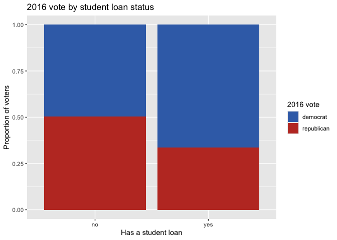
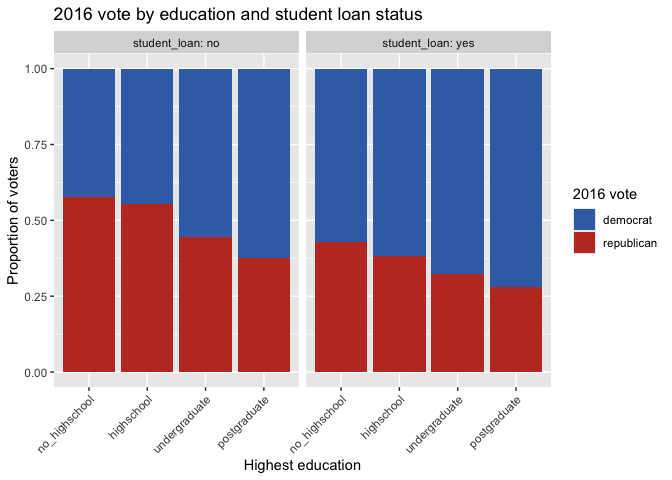
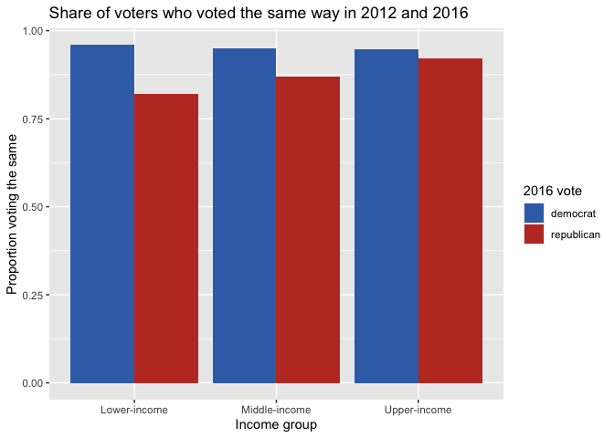
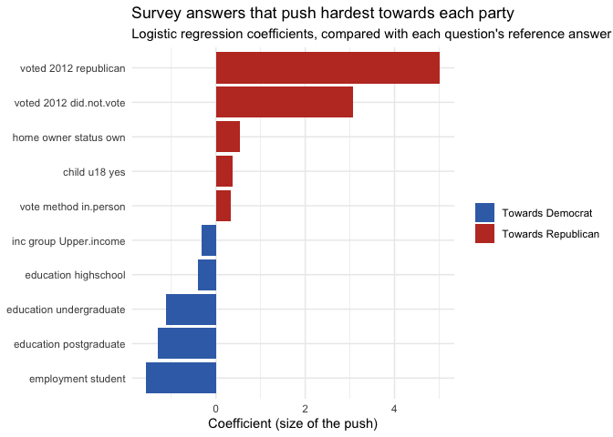

Predicting Voting Behaviour
================
Rajshree Ghimiray
2026-11-06

## About this project

This project predicts whether a voter supported the Democrats or
Republicans in the 2016 US presidential election, using their answers to
a pre-election survey. It compares three models (logistic regression,
k-nearest neighbours and random forest) and identifies which survey
answers matter most.

The data comes from the 2016 Cooperative Congressional Election Study.
It began as a university assignment and was rebuilt and extended
independently, using the full cleaned dataset.

## Load the data

``` r
library(tidyverse)   # tools for cleaning data and making charts
library(tidymodels)  # tools for building and evaluating models

voting_data <- read_csv("data/election.csv")

glimpse(voting_data)
```

    ## Rows: 22,733
    ## Columns: 18
    ## $ ...1              <dbl> 1, 2, 3, 4, 5, 6, 7, 8, 9, 10, 11, 12, 13, 14, 15, 1…
    ## $ ballot_ID         <chr> "35235", "59595", "39250", "79507", "00909", "18431"…
    ## $ state             <chr> "New Hampshire", "Colorado", "Pennsylvania", "Georgi…
    ## $ county            <chr> "Hillsborough NH", "Larimer CO", "Clearfield PA", "M…
    ## $ voted_2016        <chr> "republican", "democrat", NA, "republican", "republi…
    ## $ student_loan      <chr> "no", "no", NA, "no", "no", "no", "no", "no", "no", …
    ## $ faminc            <dbl> 32, 7, 1, 4, 7, 2, 1, 2, 6, 2, 4, 4, 7, 3, 32, 4, 32…
    ## $ child_u18         <chr> "no", "yes", "yes", "yes", "no", "yes", "no", "no", …
    ## $ followed_event_fb <chr> NA, "No", "No", "No", "No", "No", "No", "No", "No", …
    ## $ education         <chr> "highschool", "undergraduate", "no_highschool", "hig…
    ## $ employment        <chr> "other", "employed", "unemployed", "unemployed", "em…
    ## $ social_media      <chr> "No", "Yes", "Yes", "Yes", "Yes", "Yes", "Yes", "Yes…
    ## $ marital_status    <chr> "Married", "Married", "Separated", "Married", "Marri…
    ## $ home_owner_status <chr> "own", "own", "rent", "own", "own", "other", "rent",…
    ## $ voted_2012        <chr> NA, "democrat", NA, "republican", "republican", NA, …
    ## $ birth_year        <lgl> NA, NA, NA, NA, NA, NA, NA, NA, NA, NA, NA, NA, NA, …
    ## $ vote_method       <chr> "in person", "in person", NA, "in person", "in perso…
    ## $ health_insurance  <chr> "no", "no", "yes", "no", "no", "yes", "no", "yes", "…

## Check for duplicates

Each ballot ID should appear only once. This check returns no rows, so
there are no duplicate respondents.

``` r
# Count how many times each ID appears, then keep any that appear more than once.
# There's no <- here, so nothing is saved or changed; it just prints the answer.
count(voting_data, ballot_ID) %>% filter(n > 1)
```

<div class="kable-table">

| ballot_ID |   n |
|:----------|----:|

</div>

## Explore missing values

birth_year is missing for every respondent, so it can’t be used.
voted_2016, the outcome being predicted, is missing for about a third of
respondents, and a small number answered “did not vote” or “not sure”.

``` r
# How many missing values in each column?
colSums(is.na(voting_data))
```

    ##              ...1         ballot_ID             state            county 
    ##                 0                 0                 0                17 
    ##        voted_2016      student_loan            faminc         child_u18 
    ##              7726              3982                 7                53 
    ## followed_event_fb         education        employment      social_media 
    ##              6898                 0                 0                 0 
    ##    marital_status home_owner_status        voted_2012        birth_year 
    ##                13                22              5362             22733 
    ##       vote_method  health_insurance 
    ##              6406                 0

``` r
# What answers appear in voted_2016, and how often?
count(voting_data, voted_2016)
```

<div class="kable-table">

| voted_2016   |    n |
|:-------------|-----:|
| democrat     | 7803 |
| did not vote |   25 |
| not sure     |   78 |
| republican   | 7101 |
| NA           | 7726 |

</div>

## Keep only Democrat and Republican voters

A model can only learn from people whose vote is known, so only
respondents who answered Democrat or Republican are kept. This also
removed most of the missing values in other columns, such as
`vote_method`, suggesting the same people skipped several questions.

``` r
# %>% is the pipe: read it as "and then".
# filter() keeps rows that match a condition.
# %in% means "is one of these".
voters <- voting_data %>%
  filter(voted_2016 %in% c("democrat", "republican"))

# Check missing values again after filtering
colSums(is.na(voters))
```

    ##              ...1         ballot_ID             state            county 
    ##                 0                 0                 0                15 
    ##        voted_2016      student_loan            faminc         child_u18 
    ##                 0                30                 3                34 
    ## followed_event_fb         education        employment      social_media 
    ##              4871                 0                 0                 0 
    ##    marital_status home_owner_status        voted_2012        birth_year 
    ##                 8                12              1512             14904 
    ##       vote_method  health_insurance 
    ##                22                 0

## Remove unhelpful columns

`followed_event_fb` was missing for about a third of voters and wasn’t
among the top predictors in the original version of this analysis, so
the column was removed rather than losing a third of the sample.
`birth_year` is empty, `county` has too many unique values for the
models to learn from, and `...1` is just a row number. `ballot_ID` is
kept as an identifier but will be excluded from modelling.

``` r
# select() picks columns; the minus sign means "everything except these"
voters <- voters %>%
  select(-c(...1, county, birth_year, followed_event_fb))
```

## Clean 2012 vote

Respondents who said they “did not vote” in 2012 are kept as their own
category. They voted in 2016 but not 2012, often because they were too
young or newly eligible, which is real information rather than missing
data. Only “not sure” and missing answers are removed.

``` r
# Answers before cleaning
count(voters, voted_2012)
```

<div class="kable-table">

| voted_2012   |    n |
|:-------------|-----:|
| democrat     | 7402 |
| did not vote |  229 |
| not sure     |  115 |
| republican   | 5646 |
| NA           | 1512 |

</div>

``` r
# Keep democrat, republican and did not vote
voters <- voters %>%
  filter(voted_2012 %in% c("democrat", "republican", "did not vote"))

# Answers after cleaning
count(voters, voted_2012)
```

<div class="kable-table">

| voted_2012   |    n |
|:-------------|-----:|
| democrat     | 7402 |
| did not vote |  229 |
| republican   | 5646 |

</div>

## Group family income

Family income was recorded as survey codes rather than dollar amounts,
so the codes were grouped into lower, middle and upper income based on
the 2016 U.S. Census Bureau median household income of \$59,039.
Respondents who skipped the question, weren’t asked it or preferred not
to say were removed.

``` r
# ! means "not": keep rows where the code is NOT one of the unknowns
# 1:4 is shorthand for 1, 2, 3, 4
# mutate() creates a new column; case_when() is a list of rules, ~ means "then"
voters <- voters %>%
  filter(!faminc %in% c(31, 98, 99)) %>%
  mutate(inc_group = case_when(
    faminc %in% 1:4 ~ "Lower-income",
    faminc %in% 5:10 ~ "Middle-income",
    faminc %in% c(11:16, 97, 32) ~ "Upper-income"
  )) %>%
  select(-faminc)   # drop the old code column, since inc_group replaces it

count(voters, inc_group)
```

<div class="kable-table">

| inc_group     |    n |
|:--------------|-----:|
| Lower-income  | 3527 |
| Middle-income | 6765 |
| Upper-income  | 2950 |
| NA            |    2 |

</div>

## Remove remaining missing values

After the steps above, only a small number of respondents still have a
missing answer, so these rows are removed. This leaves 13,160 voters.

``` r
# drop_na() removes any row with a missing value in any column
voters <- voters %>%
  drop_na()

nrow(voters)
```

    ## [1] 13160

## Convert categories to factors

Category columns are converted from plain text to factors, R’s format
for categories is a fixed set of options, which the models need.
Education is also put in a logical order, from no high school to
postgraduate, so charts show it from lowest to highest.

``` r
# across() applies the same change to several columns at once:
# every text column except ballot_ID (a label, not a category) becomes a factor
voters <- voters %>%
  mutate(across(c(where(is.character), -ballot_ID), as.factor))

# Set education levels from lowest to highest instead of alphabetical
voters <- voters %>%
  mutate(education = factor(education,
    levels = c("no_highschool", "highschool", "undergraduate", "postgraduate")))

glimpse(voters)
```

    ## Rows: 13,160
    ## Columns: 14
    ## $ ballot_ID         <chr> "59595", "79507", "00909", "36068", "05160", "74332"…
    ## $ state             <fct> Colorado, Georgia, Pennsylvania, Florida, Michigan, …
    ## $ voted_2016        <fct> democrat, republican, republican, republican, democr…
    ## $ student_loan      <fct> no, no, no, no, no, no, yes, no, no, no, no, no, no,…
    ## $ child_u18         <fct> yes, yes, no, no, no, no, yes, no, no, no, no, no, n…
    ## $ education         <fct> undergraduate, highschool, highschool, highschool, h…
    ## $ employment        <fct> employed, unemployed, employed, retired, employed, r…
    ## $ social_media      <fct> Yes, Yes, Yes, Yes, Yes, No, Yes, No, Yes, No, Yes, …
    ## $ marital_status    <fct> Married, Married, Married, Divorced, Domestic partne…
    ## $ home_owner_status <fct> own, own, own, rent, own, own, rent, own, own, own, …
    ## $ voted_2012        <fct> democrat, republican, republican, republican, democr…
    ## $ vote_method       <fct> in person, in person, in person, by mail, in person,…
    ## $ health_insurance  <fct> no, no, no, yes, no, yes, yes, no, yes, yes, no, no,…
    ## $ inc_group         <fct> Middle-income, Lower-income, Middle-income, Lower-in…

## Check social media variation

The original version of this analysis removed `social_media` on the
basis that it didn’t vary. Checking it shows about two-thirds of voters
answered yes and one-third no, so it was kept.

``` r
count(voters, social_media)
```

<div class="kable-table">

| social_media |    n |
|:-------------|-----:|
| No           | 4408 |
| Yes          | 8752 |

</div>

## Exploratory data analysis

### Overall vote split

Unlike the original assignment, which required a balanced sample of
3,000, this analysis uses all 13,160 cleaned responses. The split is
close to even (53% Democrat, 47% Republican), so no rebalancing is
needed. This also gives a baseline: always guessing Democrat would be
right 52.7% of the time, so any useful model must do better than that.

``` r
count(voters, voted_2016) %>%
  mutate(proportion = round(n / sum(n), 3))
```

<div class="kable-table">

| voted_2016 |    n | proportion |
|:-----------|-----:|-----------:|
| democrat   | 6934 |      0.527 |
| republican | 6226 |      0.473 |

</div>

### Vote by student loan status

``` r
# position = "fill" stretches each bar to 100%, showing proportions rather than counts
ggplot(voters, aes(x = student_loan, fill = voted_2016)) +
  geom_bar(position = "fill") +
  labs(title = "2016 vote by student loan status",
       x = "Has a student loan",
       y = "Proportion of voters",
       fill = "2016 vote") +
  scale_fill_manual(values = c("democrat" = "#3B6FB6", "republican" = "#C0392B"))
```

<!-- -->

Voters without a student loan were split roughly 50/50, while voters
with a student loan leaned clearly Democrat, about two-thirds to
one-third.

### Vote by education and student loan status

``` r
# facet_wrap() splits the chart into side-by-side panels, one per loan status;
# label_both labels each panel "student_loan: no" and "student_loan: yes"
ggplot(voters, aes(x = education, fill = voted_2016)) +
  geom_bar(position = "fill") +
  facet_wrap(~ student_loan, labeller = label_both) +
  labs(title = "2016 vote by education and student loan status",
       x = "Highest education",
       y = "Proportion of voters",
       fill = "2016 vote") +
  scale_fill_manual(values = c("democrat" = "#3B6FB6", "republican" = "#C0392B")) +
  theme(axis.text.x = element_text(angle = 45, hjust = 1))   # tilt labels so they don't overlap
```

<!-- --> In both
groups, the share voting Republican falls as education rises, from about
57% among people without a high school education to about 37% among
postgraduates (for those without a student loan). Having a student loan
shifts every education level further towards the Democrats: among people
with a loan, no education group had a Republican majority, while among
those without one, voters with high school or less leaned Republican.

### Vote consistency between 2012 and 2016 by income

This looks at what share of each income group voted for the same party
in 2016 as in 2012. Respondents who didn’t vote in 2012 are left out of
this comparison only, since they can’t have voted the same way.

``` r
consistency <- voters %>%
  filter(voted_2012 != "did not vote") %>%
  # TRUE if their 2016 vote matches their 2012 vote. as.character() is needed
  # because R won't compare factors with different sets of levels
  mutate(same_vote = as.character(voted_2016) == as.character(voted_2012)) %>%
  # Split voters into 6 groups (3 income groups x 2 parties)
  group_by(inc_group, voted_2016) %>%
  summarise(
    count_same_vote = sum(same_vote),   # sum() counts the TRUEs
    total_voters = n(),                 # n() counts voters in the group
    proportion_same_vote = round(count_same_vote / total_voters, 3),
    # Remove the grouping once the summary is done, so it doesn't affect
    # later calculations. inc_group is still kept as a column
    .groups = "drop")

consistency
```

<div class="kable-table">

| inc_group     | voted_2016 | count_same_vote | total_voters | proportion_same_vote |
|:--------------|:-----------|----------------:|-------------:|---------------------:|
| Lower-income  | democrat   |            1851 |         1931 |                0.959 |
| Lower-income  | republican |            1239 |         1511 |                0.820 |
| Middle-income | democrat   |            3324 |         3494 |                0.951 |
| Middle-income | republican |            2709 |         3113 |                0.870 |
| Upper-income  | democrat   |            1368 |         1443 |                0.948 |
| Upper-income  | republican |            1326 |         1442 |                0.920 |

</div>

``` r
# geom_col() uses the proportions already calculated in the table;
# position = "dodge" puts the two parties' bars side by side
ggplot(consistency, aes(x = inc_group, y = proportion_same_vote, fill = voted_2016)) +
  geom_col(position = "dodge") +
  labs(title = "Share of voters who voted the same way in 2012 and 2016",
       x = "Income group",
       y = "Proportion voting the same",
       fill = "2016 vote") +
  scale_fill_manual(values = c("democrat" = "#3B6FB6", "republican" = "#C0392B"))
```

<!-- -->

Democrats were highly consistent across all income groups, with about
95% having also voted Democrat in 2012. Republican consistency rose with
income, from 82% among lower-income voters to 87% among middle-income
and 92% among upper-income voters. Since non-voters in 2012 were
excluded, the inconsistent Republicans must have voted Democrat in 2012,
meaning lower-income 2016 Republican voters were the most likely to have
switched from the Democrats.

## Modelling

To judge whether a model is any good, it has to be tested on people it
hasn’t seen. The voters were split into a training set (80%), which the
models learn from, and a test set (20%), which is kept aside and only
used at the end to measure how well each model predicts. The split is
stratified by 2016 vote, so both sets keep the same 53/47 party mix.

### Split into training and test sets

``` r
# set.seed() makes the random split the same every time the code runs
set.seed(2026)

# Decide who goes in each set: 80% training, 20% test,
# keeping the same party mix in both (strata)
data_split <- initial_split(voters, prop = 0.8, strata = voted_2016)

# Create the two sets
train_data <- training(data_split)
test_data <- testing(data_split)

nrow(train_data)
```

    ## [1] 10527

``` r
nrow(test_data)
```

    ## [1] 2633

This gives 10,527 voters for training and 2,633 for testing.

### Prepare the data for modelling

A recipe sets out how the data is prepared before modelling. It predicts
2016 vote from every other column, keeps `ballot_ID` as an identifier
without using it to predict, removes any column where everyone gave the
same answer, and converts categories into 1/0 dummy variables, since
logistic regression and kNN need numbers to work with. The same recipe
is used for both of those models.

``` r
# ~ means "predicted by" and . means "every other column"
data_recipe <- recipe(voted_2016 ~ ., data = train_data) %>%
  update_role(ballot_ID, new_role = "id") %>%     # keep the ID, but don't predict with it
  step_zv(all_predictors()) %>%                   # drop columns with only one value
  step_dummy(all_nominal_predictors())            # turn categories into 1/0 columns

data_recipe
```

### Model 1: Logistic regression

Every model follows the same steps: choose the model, combine it with
the recipe, train it on the training data, predict the test data, then
check how many predictions were right.

``` r
# 1. Choose the model: logistic regression, using R's built-in glm,
#    predicting a category rather than a number
log_spec <- logistic_reg() %>%
  set_engine("glm") %>%
  set_mode("classification")

# 2. Combine the recipe and model so the data is always prepared the same way
log_workflow <- workflow() %>%
  add_recipe(data_recipe) %>%
  add_model(log_spec)

# 3. Train the model on the training data
log_fit <- log_workflow %>%
  fit(data = train_data)

# 4. It gives the trained model the test voters and gets its guesses back, all in one table.
# augment() makes the model predict each of those voters, then adds the predictions as new columns onto the test data. 
# log_preds <- saves the result under the name log_preds.
# .pred_class is the model’s guess
# .pred_democrat and .pred_republican are the probabilities behind that guess (they always add up to 1)
log_preds <- augment(log_fit, new_data = test_data)

# 5. Check the predictions against the real votes
# Goes through all 2,633 test voters, checks whether the guess matches the real vote, and gives the share that matched.
log_preds %>% accuracy(truth = voted_2016, estimate = .pred_class)
```

<div class="kable-table">

| .metric  | .estimator | .estimate |
|:---------|:-----------|----------:|
| accuracy | binary     | 0.9156855 |

</div>

``` r
# Instead of one number, this sorts every voter into one of four boxes, depending on their guess and real vote, and counts them.
log_preds %>% conf_mat(truth = voted_2016, estimate = .pred_class)
```

    ##             Truth
    ## Prediction   democrat republican
    ##   democrat       1308        143
    ##   republican       79       1103

Logistic regression correctly predicted 91.6% of test voters, far above
the 52.7% baseline. It identified 94.3% of Democrats (sensitivity) but
88.5% of Republicans (specificity). Its most common mistake was
predicting Democrat for Republicans, which fits the consistency finding
above: some 2016 Republican voters had voted Democrat in 2012, and since
past vote is the strongest predictor, the model tends to miss these
switchers.

# 1. Choose the model: k-nearest neighbours (kNN)

kNN guesses a voter’s party by finding the k training voters whose
answers are most similar to theirs, then going with the majority vote
among them.

``` r
knn_spec <- nearest_neighbor(
    # neighbors is k, the number of similar voters to look at.
    # tune() leaves it blank for now; the best value is found later
    # by testing several options on practice rounds.
    neighbors = tune()
  ) %>%
  # kknn is the package that does the calculations
  set_engine("kknn") %>%
  # Predicting a category (democrat or republican), not a number
  set_mode("classification")
```

# 2. Combine the recipe and the model

``` r
knn_workflow <- workflow() %>%
  add_recipe(data_recipe) %>%
  add_model(knn_spec)
```

# 3. Set up the practice rounds and the k values to try

``` r
# set.seed() makes the random grouping the same every time the code runs
set.seed(2026)

# Cross-validation: cut the TRAINING voters into 5 equal groups (v = 5).
# Each k will be tested 5 times: each time, 4 groups act as the neighbours
# and the 5th group is guessed and scored. The test set is not used here.
# strata keeps the same 53/47 party mix in every group.
folds <- vfold_cv(train_data, v = 5, strata = voted_2016)

# The k values to try: 10 evenly spaced values between 50 and 300
# (about 50, 78, 105, 133 ... 300).
k_grid <- grid_regular(neighbors(range = c(50, 300)), levels = 10)
# An initial search from 1 to 100 selected k = 100, the edge of the range, so the search was widened to 300. Accuracy was almost the same for any k above about 100, so k = 300 was kept.
```

# 4. Try every k on every practice exam

``` r
# “For every k, do the hide-guess-check routine 5 times and record the score.” (Part 3, steps 2 to 6)
knn_tune <- knn_workflow %>%
  tune_grid(resamples = folds, grid = k_grid, metrics = metric_set(accuracy))
```

# 5. Pick the best k and train the final model on all the training data

``` r
# “Which k scored best?”
best_k <- select_best(knn_tune, metric = "accuracy")
best_k
```

<div class="kable-table">

| neighbors | .config          |
|----------:|:-----------------|
|       300 | pre0_mod10_post0 |

</div>

``` r
# “Build the final model with that k, using all training voters as neighbours.”

knn_fit <- knn_workflow %>%
  finalize_workflow(best_k) %>%
  fit(data = train_data)
```

#### Predict the test data

``` r
# 6. Predict the test voters and check against their real votes
knn_preds <- augment(knn_fit, new_data = test_data)
knn_preds %>% accuracy(truth = voted_2016, estimate = .pred_class)
```

<div class="kable-table">

| .metric  | .estimator | .estimate |
|:---------|:-----------|----------:|
| accuracy | binary     | 0.8583365 |

</div>

``` r
knn_preds %>% conf_mat(truth = voted_2016, estimate = .pred_class)
```

    ##             Truth
    ## Prediction   democrat republican
    ##   democrat       1265        251
    ##   republican      122        995

kNN correctly predicted 85.8% of test voters, lower than logistic
regression but well above the 52.7% baseline. It identified 91.2% of
Democrats but only 79.9% of Republicans, wrongly predicting 251
Republicans as Democrats compared with 143 for logistic regression.

### Model 3: Random forest

A random forest builds many decision trees, each asking a chain of
yes/no questions about a voter’s answers, and lets the trees vote. Trees
can work with categories directly, so this model uses its own recipe
without dummy variables. Two settings were tuned with the same 5 folds
as kNN: `mtry`, the number of questions each tree can choose from at
each split, and `min_n`, the smallest group a tree is allowed to split.

``` r
# Recipe without step_dummy(): trees can use categories as they are
rf_recipe <- recipe(voted_2016 ~ ., data = train_data) %>%
  update_role(ballot_ID, new_role = "id") %>%
  step_zv(all_predictors())

# 1. Choose the model: 100 trees, with mtry and min_n left to be tuned.
#    importance = "permutation" also records which questions matter most
rf_spec <- rand_forest(trees = 100, mtry = tune(), min_n = tune()) %>%
  set_engine("ranger", importance = "permutation") %>%
  set_mode("classification")

# 2. Combine the recipe and model
rf_workflow <- workflow() %>%
  add_recipe(rf_recipe) %>%
  add_model(rf_spec)

# 3. 5 values of mtry (1 to 12, since there are 12 questions) and
#    5 values of min_n (2 to 10), giving 5 x 5 = 25 combinations
rf_grid <- grid_regular(mtry(range = c(1, 12)), min_n(range = c(2, 10)), levels = 5)

# 4. Test every combination on the same 5 folds as kNN
rf_tune <- rf_workflow %>%
  tune_grid(resamples = folds, grid = rf_grid, metrics = metric_set(accuracy))

show_best(rf_tune, metric = "accuracy")
```

<div class="kable-table">

| mtry | min_n | .metric  | .estimator |      mean |   n |   std_err | .config          |
|-----:|------:|:---------|:-----------|----------:|----:|----------:|:-----------------|
|    3 |     8 | accuracy | binary     | 0.9095672 |   5 | 0.0033580 | pre0_mod09_post0 |
|    3 |    10 | accuracy | binary     | 0.9092822 |   5 | 0.0033661 | pre0_mod10_post0 |
|    3 |     4 | accuracy | binary     | 0.9092822 |   5 | 0.0033260 | pre0_mod07_post0 |
|    3 |     6 | accuracy | binary     | 0.9091872 |   5 | 0.0031462 | pre0_mod08_post0 |
|    3 |     2 | accuracy | binary     | 0.9090921 |   5 | 0.0031186 | pre0_mod06_post0 |

</div>

``` r
# 5. Use the best combination and train the final model
best_rf <- select_best(rf_tune, metric = "accuracy")

rf_fit <- rf_workflow %>%
  finalize_workflow(best_rf) %>%
  fit(data = train_data)

# 6. Predict the test voters and check against their real votes
rf_preds <- augment(rf_fit, new_data = test_data)
rf_preds %>% accuracy(truth = voted_2016, estimate = .pred_class)
```

<div class="kable-table">

| .metric  | .estimator | .estimate |
|:---------|:-----------|----------:|
| accuracy | binary     | 0.9160653 |

</div>

``` r
rf_preds %>% conf_mat(truth = voted_2016, estimate = .pred_class)
```

    ##             Truth
    ## Prediction   democrat republican
    ##   democrat       1308        142
    ##   republican       79       1104

The best settings were mtry = 3 and min_n = 8, both inside their tested
ranges. All five top combinations used mtry = 3, while min_n made little
difference. The random forest correctly predicted 91.6% of test voters,
almost identical to logistic regression.

## Comparing the models

All three models were scored on the same test set using four measures:
accuracy (share of all predictions that were right), sensitivity (share
of Democrats correctly identified), specificity (share of Republicans
correctly identified) and AUC (how well the model ranks likely Democrats
above likely Republicans, from 0.5 for a coin flip to 1 for perfect).

``` r
# The four scores to calculate for each model.
# yardstick::spec is written in full because another package also has a spec() function
my_metrics <- metric_set(accuracy, sens, yardstick::spec, roc_auc)

# Calculate the scores for each model, label them, and stack them into one table.
# .pred_democrat (the predicted probability) is needed for AUC
bind_rows(
  log_preds %>% my_metrics(truth = voted_2016, estimate = .pred_class, .pred_democrat) %>%
    mutate(model = "Logistic regression"),
  knn_preds %>% my_metrics(truth = voted_2016, estimate = .pred_class, .pred_democrat) %>%
    mutate(model = "kNN"),
  rf_preds %>% my_metrics(truth = voted_2016, estimate = .pred_class, .pred_democrat) %>%
    mutate(model = "Random forest")
) %>%
  # Reshape into one row per model and one column per score, rounded to 3 decimals
  select(model, .metric, .estimate) %>%
  pivot_wider(names_from = .metric, values_from = .estimate) %>%
  mutate(across(where(is.numeric), ~ round(.x, 3)))
```

<div class="kable-table">

| model               | accuracy |  sens |  spec | roc_auc |
|:--------------------|---------:|------:|------:|--------:|
| Logistic regression |    0.916 | 0.943 | 0.885 |   0.933 |
| kNN                 |    0.858 | 0.912 | 0.799 |   0.908 |
| Random forest       |    0.916 | 0.943 | 0.886 |   0.930 |

</div>

kNN was the weakest model on every measure, particularly at identifying
Republicans. Logistic regression and random forest performed almost
identically: both reached 91.6% accuracy, with random forest correct for
just one more voter and logistic regression slightly ahead on AUC. Since
their performance was effectively tied, logistic regression was chosen
as the final model. It is simpler and faster, and its coefficients show
both how strongly and in which direction each answer is linked to a
voter’s choice.

## Which answers matter most?

Each logistic regression coefficient shows how much an answer shifts the
odds of voting Republican, compared with that question’s reference
answer, holding the other answers constant. Positive values push towards
Republican and negative values towards Democrat. State coefficients are
left out, as states with few respondents can produce large values by
chance.

``` r
# Pull the coefficients out of the model, drop the intercept (the starting
# point before any answers are added), and convert each to an odds ratio
log_coefs <- tidy(log_fit) %>%
  filter(term != "(Intercept)") %>%
  mutate(odds_ratio = exp(estimate))

log_coefs %>%
  filter(!str_starts(term, "state_")) %>%           # leave out the state columns
  slice_max(abs(estimate), n = 10) %>%              # 10 biggest pushes in either direction
  mutate(direction = if_else(estimate > 0, "Towards Republican", "Towards Democrat"),
         term = str_replace_all(term, "_", " ")) %>%  # readable labels
  ggplot(aes(x = estimate, y = reorder(term, estimate), fill = direction)) +
  geom_col() +
  labs(title = "Survey answers that push hardest towards each party",
       subtitle = "Logistic regression coefficients, compared with each question's reference answer",
       x = "Coefficient (size of the push)",
       y = NULL,
       fill = NULL) +
  scale_fill_manual(values = c("Towards Democrat" = "#3B6FB6",
                               "Towards Republican" = "#C0392B")) +
  theme_minimal()
```

<!-- -->

Voting Republican in 2012 had by far the largest effect, followed by not
having voted in 2012, both compared with having voted Democrat. Home
ownership, having a child under 18 and voting in person each pushed
slightly towards the Republicans. On the Democrat side, the effect of
education grew with each level, and students had the strongest Democrat
lean: holding other answers constant, their odds of voting Republican
were about one-fifth of those of employed respondents. These are
associations, not causes. A 2012 vote, for example, reflects underlying
party loyalty rather than causing a 2016 vote.

## Conclusion

Using pre-election survey answers from 13,160 voters, logistic
regression predicted 2016 presidential votes with 91.6% accuracy, well
above the 52.7% baseline of always guessing the larger party. Random
forest performed equally well and kNN somewhat worse. How someone voted
in 2012 was by far the strongest predictor, several times larger than
any other answer. Education, student status and home ownership also had
clear but much smaller associations with the vote.

The model’s most common mistake was predicting Democrat for Republican
voters. This matches the consistency analysis: some 2016 Republican
voters, especially lower-income ones, had voted Democrat in 2012, and
because past vote carries so much weight, the model tends to miss these
switchers.

## Limitations

- The survey only includes people who said they voted Democrat or
  Republican, so the findings don’t apply to non-voters or third-party
  voters.
- Income groups are based on the national median and aren’t adjusted for
  household size or cost of living, which vary widely across states.
- The coefficients show associations, not causes. Several answers, such
  as education and student loans, are also linked to each other, so
  their separate effects should be read with care.
- Because past vote dominates the model, its accuracy mainly reflects
  how stable party loyalty is. A useful next step would be to test how
  well demographics alone predict the vote, without the 2012 vote.
